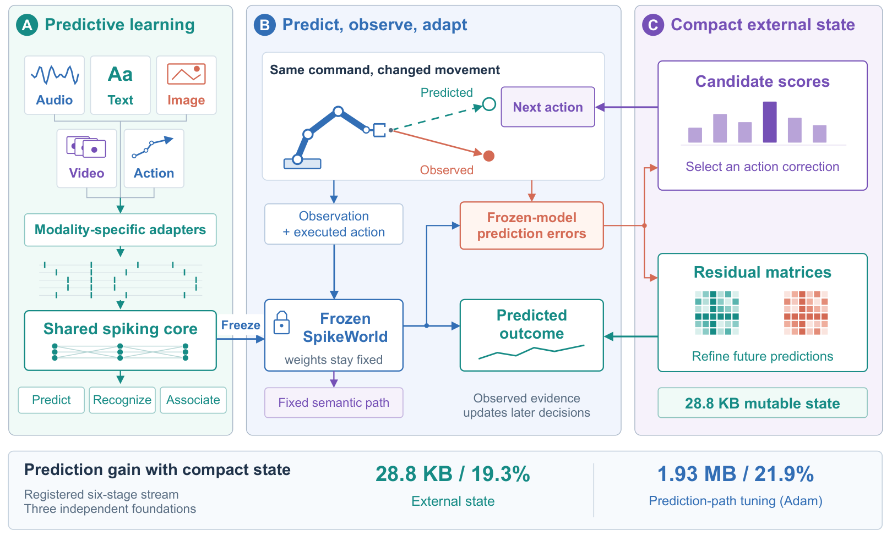
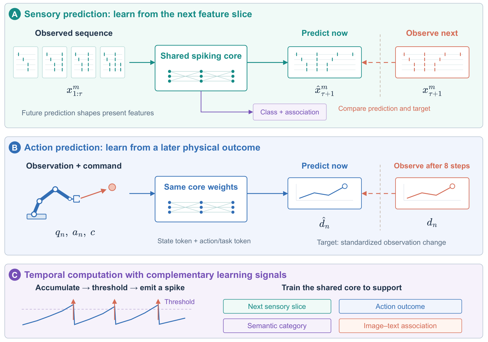

# SpikeWorld

**Adapting Frozen World Models with Compact State**

A robot's motors weaken. Its world model still predicts the old movement.
Can the robot learn from the mismatch while keeping its trained model fixed?

SpikeWorld stores what it learns in a small external state. One part corrects
future predictions; another selects a bounded action correction from a known
set of actuator changes.

[Paper](paper/SpikeWorld.pdf) · [Paper source and editable figures](paper/) ·
[Reproduction guide](REPRODUCIBILITY.md) · [Available artifacts](artifacts/README.md)

## The idea

1. **Learn to predict.** A shared spiking core learns sensory and action predictions,
   semantic recognition, and image–text association.
2. **Freeze the model.** At deployment, all trained parameters stay fixed.
3. **Remember the mismatch.** After an outcome arrives, residual matrices learn a
   prediction correction and candidate scores select a later action correction.



The two online components have separate jobs. Removing the matrices changes
prediction accuracy but leaves the selected commands unchanged. The original
semantic mapping is preserved: the same input still produces the same logits.

## What does “next-spike” predict?

Each sensory adapter turns its input into a feature sequence. The spiking core
uses the observed prefix to predict the next feature slice. The action branch
uses the same core to predict an observation change eight environment steps ahead.
Category and association heads read the shared features too.



The core uses spikes; the prediction targets remain in each stream's encoded
feature space. The sensory and action tasks use different prediction horizons.

## Main result

On the registered six-stage actuator-change stream:

| Method | Prediction-error reduction | Mutable numeric state |
|---|---:|---:|
| **SpikeWorld external state** | **19.28%** | **28.8 KB** |
| Prediction-path fine-tuning (Adam) | 21.85% | 1.93 MB |

This comparison uses three independently trained foundations, each with three
action seeds. Mutable state counts persistent adaptation tensors and buffers,
including optimizer state where used; it excludes the frozen model and transient
activations. A separate live-control experiment measures the effect on reward.
The paper reports all comparison arms and explains each protocol.

## Try the recorded-result checks

Clone the repository and use Python **3.11**. These checks need only the standard library:

```bash
git clone https://github.com/Oooorca/SpikeWorld.git
cd SpikeWorld
python tools/verify_current.py
python tools/verify_preprint.py
```

They check the recorded files and recompute the paper's reported summaries.
They do not launch training.

To install the reference model and run its tests:

```bash
uv sync --locked --extra train --extra dev
uv run pytest -q
uv run spikeworld-verify
uv run spikeworld-fetch
uv run spikeworld-audit --config configs/audit.toml
```

`spikeworld-verify` checks the earlier result snapshot. `spikeworld-fetch` downloads
or verifies a representative historical checkpoint. The current paper's records
are under `results/current/`. Fresh training and control runs require the additional
inputs listed in the [reproduction guide](REPRODUCIBILITY.md).

## Find your way around

| Path | Contents |
|---|---|
| [`model.py`](src/spikeworld/model.py) | Input adapters, spiking core, and readouts |
| [`training.py`](src/spikeworld/training.py) | Sensory, semantic, binding, and action losses |
| [`adaptation.py`](src/spikeworld/adaptation.py) | Candidate scores, residual matrices, routing, and memory accounting |
| [`experiments/`](src/spikeworld/experiments/) | Reference training, adaptation, control, and audit runners |
| [`results/current/`](results/current/) | Current recorded results and comparison arms |
| [`paper/`](paper/) | PDF, LaTeX, numerical figures, and editable draw.io diagrams |

To rebuild the PDF, follow [paper/README.md](paper/README.md). To regenerate the
numerical plots and tables, install Matplotlib and run
`python tools/build_paper_assets.py`. Figures 1 and 2 are edited in draw.io and
are preserved by that script.

The November 2026 revision clarifies the paper and release using existing
experimental records. Earlier repository versions remain in Git history.
